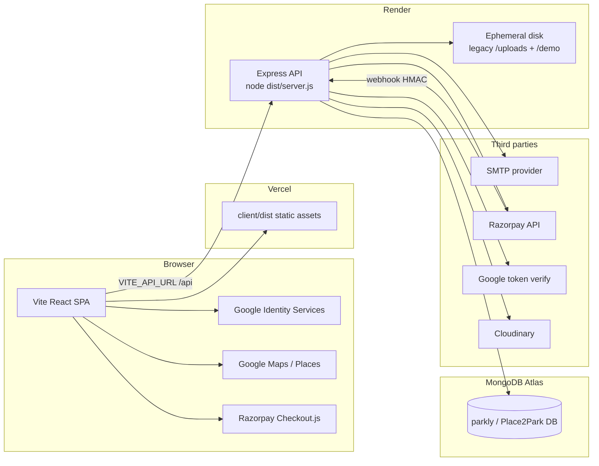
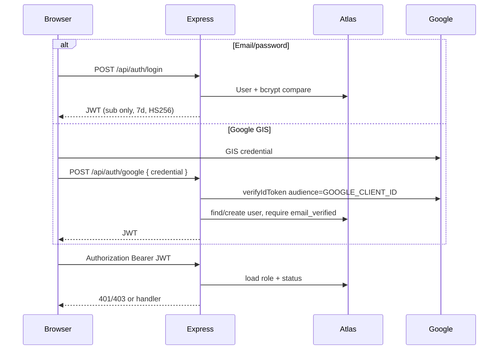
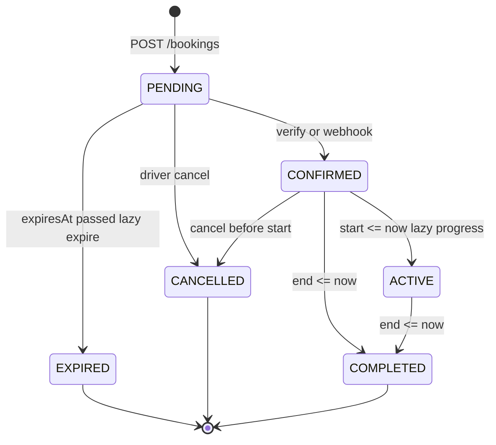
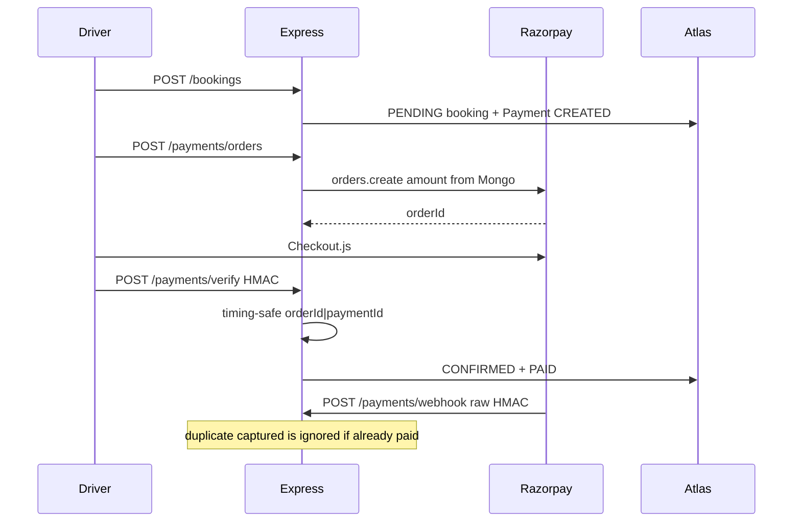

# Place2Park system design

This document describes the **verified** architecture of the Place2Park (Parkly) parking marketplace as implemented in this repository. Proposed improvements are labeled separately and are **not** implemented here.

**Product:** drivers search and book private parking; hosts list spaces; admins moderate. Money is INR (paise in MongoDB). GeoJSON coordinates are `[longitude, latitude]`.

**Verified stack**

| Layer | Technology | Evidence |
|---|---|---|
| Frontend | React 19 + TypeScript + Vite 6, Tailwind 4 | `client/package.json`, `client/src/main.tsx` |
| Backend | Node.js + Express 4 + TypeScript | `server/package.json`, `server/src/server.ts` |
| Database | MongoDB Atlas via Mongoose 8 | `server/src/config/db.ts` |
| Auth | JWT HS256 + Google Identity Services ID tokens | `server/src/middleware/auth.ts`, `server/src/controllers/auth.controller.ts` |
| Payments | Razorpay orders, checkout HMAC, webhooks, refunds | `server/src/services/payments.ts`, `server/src/services/bookings.ts` |
| Maps | Google Maps JS + Places; catalog fallback | `client/src/lib/google-maps.ts`, `client/src/components/map/places-autocomplete.tsx` |
| Email | Nodemailer SMTP | `server/src/services/email.ts` |
| Deploy | Vercel (SPA) + Render (API) | `vercel.json`, `client/vercel.json`; Render start is `npm run build && npm start` |

---

## 1. Current architecture and deployment



**Local development (verified):** Vite on `:5173` proxies `/api`, `/uploads`, `/demo` to Express on `:5000` (`client/vite.config.ts`). Production SPA and API are separate origins.

**Build (verified):**

- Client: `tsc -b && vite build` → `client/dist`
- Server: `tsc -p tsconfig.build.json` → `server/dist`, start with `node dist/server.js` (`server/package.json`)
- `tsx` is used only for `dev` and `seed`

---

## 2. Responsibilities

### Frontend (`client/src`)

- Routing and role-gated layouts (`App.tsx`, `layouts/guards.tsx`)
- Search/map UX, listing detail, booking widget, Razorpay Pay Now
- Host listing wizard, calendar, earnings views
- Admin moderation screens
- Holds JWT in `localStorage` (`services/api.ts`)
- Resolves `/uploads` and `/demo` against `VITE_API_URL` (`lib/media-url.ts`)

Does **not** compute prices of record, confirm payments, or decide availability.

### Backend (`server/src`)

- HTTP API under `/api` (`app.ts`, `routes/index.ts`)
- Auth, validation (Zod), rate limits, privacy redaction
- Search, quotes, atomic booking create, cancel + refunds
- Razorpay order/verify/webhook
- Listing photo uploads (Cloudinary in production; local `/uploads` in development) and static `/uploads` + `/demo`

### Database

- Source of truth for users, listings, bookings, payments, reviews
- 2dsphere geo queries; conflict scans on bookings
- Images are **paths**, not binaries, in MongoDB

### Third parties

| Service | Role | Verified files |
|---|---|---|
| Google Identity Services | Browser ID token | `client/src/components/google-button.tsx`, `auth.controller.ts` `googleLogin` |
| Google Maps / Places | Map tiles, autocomplete | `client/src/lib/google-maps.ts`; server catalog fallback in `parking.controller.ts` `suggestPlaces` |
| Razorpay | Orders, checkout, webhooks, refunds | `payments.ts`, `payments.controller.ts`, `bookings.ts` |
| SMTP | Password reset + in-app notify emails | `email.ts`, `notify.ts` |
| Cloudinary | Listing photo storage and delivery | `services/media.ts`, `controllers/uploads.controller.ts` |
| MongoDB Atlas | Persistence | `config/db.ts` |

---

## 3. Main modules and request flows

```
client/src/          pages, components, context/auth, services/api
server/src/
  config/            env, db, paths
  middleware/        auth, validate, error
  models/            Mongoose schemas
  controllers/       HTTP adapters
  services/          bookings, availability, search, payments, email, notify
  routes/index.ts    single router
  utils/             pricing, privacy, geo, location, rate-limit, constants
```

**Typical driver flow**

1. `GET /parking/search` → map/list (`pages/search.tsx`)
2. `GET /parking/:id` + `GET /parking/:id/quote` (`parking-detail.tsx`, `booking-widget.tsx`)
3. `POST /bookings` → PENDING hold + payment row
4. `POST /payments/orders` → Razorpay Checkout
5. `POST /payments/verify` and/or webhook → CONFIRMED
6. `GET /bookings/:id` — exact address only after confirm (`privacy.ts`)

**Host flow:** `POST /host/listings` → (non-prod auto-VERIFIED / prod PENDING_REVIEW) → photos `POST /upload` → calendar blocks → `GET /host/bookings`.

**Admin flow:** `/admin/*` behind `adminOnly`.

---

## 4. Authentication and authorization

**Verified**



- Token signs only `sub` (`middleware/auth.ts`). Role and `SUSPENDED` always come from Mongo.
- `hostOnly`: HOST, BOTH, ADMIN. `adminOnly`: ADMIN.
- Password reset: random token, SHA-256 stored, 30-minute expiry (`auth.controller.ts`). SMTP send or, in development without SMTP, log the link (`email.ts`). Production without SMTP returns 503 for all forgot-password requests (anti-enumeration).
- Client restores session via `GET /auth/me` (`context/auth.tsx`).

**Proposed (not implemented):** HttpOnly cookies instead of `localStorage`; Zod on forgot/reset bodies (`routes/index.ts` lines 32–33 have no `validate()`).

---

## 5. Parking search and availability

**Verified** — `services/search.ts`, `controllers/parking.controller.ts`, `services/availability.ts`

1. Optional `q` is geocoded via `KNOWN_AREAS` or listing-centroid average when lat/lng missing.
2. Public listings: `status ∈ {VERIFIED, ACTIVE}`.
3. If a center exists: `$geoWithin` / `$centerSphere` on GeoJSON Point (2dsphere).
4. If no center: `$regex` on locality/city/area (`utils/location.ts`).
5. Optional second geo query around the matched cluster (text-only searches).
6. Cap 100 documents; sort in memory (closest / cheapest / rating).
7. If `start` + `durationMins` present, mark availability from batched Booking + BlockedSlot overlap queries — rows are **not** dropped.

**Quote (authoritative):** `GET /parking/:id/quote` runs `validateWindow` + `hasConflict` + `computeQuote`. UI estimates in `booking-widget.tsx` are display-only.

**Window rules (verified):** allowlisted durations, min/max, not in past, ≤30 days ahead, overnight flag, host `blockedDates`, weekly `availability` rules, overlap `existing.start < requested.end AND existing.end > requested.start`. PENDING holds block only while `expiresAt > now`.

**Proposed:** text index or slugs instead of `$regex`; do not run unscoped `expireStalePendingBookings()` on every search (`search.ts`).

---

## 6. Booking creation, concurrency, state

**Verified** — `services/bookings.ts`, `utils/constants.ts`



- Create ignores client `total` / `status` / `hostId` (`bookings.controller.ts` picks trusted fields).
- Prices from `computeQuote` (`utils/pricing.ts`): driver +5% platform fee, host −10% commission (host keeps 90%), amounts in **paise**. Stored booking money fields are historical and are not rewritten.
- Hold: `PENDING_HOLD_MINS = 12`.
- Concurrency: Mongo transaction + `$inc` `ParkingSpace.__bookLock`; post-insert race check; `assertSoleOccupant` keeps oldest `_id`. Fallback if transactions unsupported.
- Status progression is **lazy** (`progressBookingStatuses` / `progressOneBooking` on list/detail), not a worker.
- `__bookLock` stripped from JSON (`ParkingSpace` transform).

**Ownership:** driver `userId`; host `hostId` from listing; admin can view. Hosts cannot cancel a driver’s booking (`403` in live booking-flow tests).

**Proposed:** atomic `findOneAndUpdate` PENDING→CONFIRMED (see P0); scheduled expiry job.

---

## 7. Razorpay: orders, verify, webhooks, cancel, refunds

**Verified** — `services/payments.ts`, `controllers/payments.controller.ts`, `services/bookings.ts`, `docs/razorpay.md`



| Step | Behavior |
|---|---|
| Create/reuse order | Amount = `booking.totalAmount`; reuse CREATED Razorpay `orderId` |
| Verify | Owner check; `payment.orderId` must match; HMAC with `RAZORPAY_KEY_SECRET` |
| Mock pay | `POST /payments/mock-confirm` → **403** |
| Webhook | Raw body HMAC with `RAZORPAY_WEBHOOK_SECRET`; `payment.captured` / `order.paid` / `payment.failed`; `refund.processed` / `refund.failed` |
| Cancel unpaid PENDING | Slot released; `refunded: false` |
| Cancel CONFIRMED started | 409 |
| Cancel paid, >60 min before start | Claim payment `refundStatus: PENDING`, `payments.refund(paymentId, { amount })` using Mongo amount |
| Refund processed | Payment `REFUNDED`, `booking.refunded = true`, `refundProcessedAt` set |
| Refund pending | Payment stays `PAID` + `refundStatus: PENDING` + `refundId` + `refundAmount` until webhook; cancel API `refunded` means requested, not completed |
| Refund API error | Payment stays `PAID`, `refundStatus: FAILED`, `refundFailedAt`, HTTP **503**; retry on later cancel; one in-flight claim prevents duplicates |

**Proposed:** persist less of `signature` at rest; require webhook secret in production boot (currently verify returns false if unset).

---

## 8. MongoDB entities, relationships, indexes, ownership

```mermaid
erDiagram
  User ||--o{ ParkingSpace : hosts
  User ||--o{ Booking : books
  User ||--o{ Vehicle : owns
  ParkingSpace ||--o{ Booking : occupies
  ParkingSpace ||--o{ BlockedSlot : blocks
  ParkingSpace ||--o{ Review : has
  Booking ||--o| Payment : pays
  Booking ||--o| Review : one
  User ||--o{ Favorite : saves
  User ||--o{ Notification : receives
  User ||--o{ Report : files
  User ||--o{ HostPayout : earnings_stub
```

| Collection | Ownership | Indexes (verified) |
|---|---|---|
| User | self / admin | unique email; sparse googleId; role |
| ParkingSpace | hostId | 2dsphere `location`; hostId+status; status+price; locality/city/area |
| Booking | userId (driver), hostId | unique code; spaceId+start+end+status; userId+start; hostId+status+start |
| Payment | via booking | unique bookingId; orderId; status; sparse refundId |
| BlockedSlot | host via space | spaceId+start+end |
| Review | one per booking | unique bookingId |
| Favorite | userId | unique userId+spaceId |
| Vehicle, Notification, Report | user | userId |
| HostPayout | hostId | unique `idempotencyKey`; bookingIds; MANUAL method; statuses REQUESTED→APPROVED→PAID / FAILED / REJECTED / REVERSED. Completed bookings are not treated as paid. |

**Privacy (verified):** exact `address`, `accessInstructions`, `placeId`, `accessCode` redacted until booking `CONFIRMED` / `ACTIVE` / `COMPLETED` (`utils/privacy.ts`, `parking.controller.ts` detail, `bookings.controller.ts`).

**Geo contract:** `location.coordinates = [lng, lat]`. Swapped India-range points are repaired on connect (`config/db.ts`).

---

## 9. Image upload and storage

**Verified**

1. Host `POST /api/upload` (auth + hostOnly + rate limit 30/10 min).
2. Multer **memory** storage; jpeg/png/webp only, 5 MB. SVG and GIF rejected (`routes/index.ts`, `services/media.ts`).
3. Production: Cloudinary upload (`folder` `place2park/listings`). Response `{ url, publicId }`. `publicId` is stored on the listing image subdocument.
4. Development without Cloudinary: write under `server/uploads`, response `{ url: "/uploads/<file>" }` (no `publicId`).
5. Listing update destroys Cloudinary assets removed from the listing **after** a successful save (`persistListingImages`). Save failure does not destroy.
6. Express still serves `/uploads` (legacy) and `/demo` (`app.ts`). SPA `mediaUrl` prefixes `/uploads` and `/demo` when `VITE_API_URL` is absolute; Cloudinary `https://` URLs pass through (`lib/media-url.ts`).

**Limitation:** photos uploaded in the wizard but never saved on a listing remain in Cloudinary. Legacy `/uploads` files on Render disk may already be gone after a restart — do not delete remaining local files until listing URLs are confirmed.

---

## 10. Email notification flow

**Verified** — `services/email.ts`, `services/notify.ts`, `auth.controller.ts`

- Resend HTTPS if `RESEND_API_KEY` is set (`POST https://api.resend.com/emails`). SMTP (`SMTP_HOST`/`PORT`/`USER`/`PASS`) is used only when no Resend key is set. From: `EMAIL_FROM` or `SMTP_USER`. Production refuses reserved/placeholder sender or recipient domains (`.test`, `.example`, `parkly.dev`). Admin payout-request mail uses `ADMIN_NOTIFICATION_EMAIL` only.
- Password reset: send link, or log full URL only in development when email is unset. Never log the raw token when a provider is configured. Delivery failure → 503, not a fake success. Unknown emails still get 200.
- `notify()` always writes `Notification`; emails only if Resend or SMTP is configured and `user.notifyEmail !== false`. Failures log `describeEmailError` (provider status/code only).
- Used on booking confirm, host new booking, cancel.

**Proposed:** do not treat outbound email as optional in production boot if reset email is a product requirement.

---

## 11. Environment variables and deployment boundaries

Never commit or paste real values. Names only.

**Server** (`server/.env`, loaded via `config/paths.ts` → `server/.env`)

| Name | Boundary | Required in production |
|---|---|---|
| `NODE_ENV` | Render | `production` (enables guards + `trust proxy`) |
| `PORT` | Render | provided by host |
| `MONGODB_URI`, `MONGODB_DB` | Atlas | URI required |
| `JWT_SECRET` | Render | ≥32 chars, not the dev fallback |
| `CLIENT_URL` | Render | exact Vercel origin (CORS); not localhost |
| `GOOGLE_CLIENT_ID` | Render | Google login |
| `GOOGLE_CLIENT_SECRET` | Render | unused by GIS ID-token flow |
| `RAZORPAY_KEY_ID`, `RAZORPAY_KEY_SECRET` | Render | checkout + refunds |
| `RAZORPAY_WEBHOOK_SECRET` | Render | webhook + refund events; **required in production** |
| `EMAIL_FROM`, `ADMIN_NOTIFICATION_EMAIL`, `RESEND_API_KEY`, `SMTP_*` | Render | password-reset + notify mail; Resend preferred; admin payout alerts |
| `CLOUDINARY_CLOUD_NAME`, `CLOUDINARY_API_KEY`, `CLOUDINARY_API_SECRET` | Render | listing photos; required in production |

**Client** (Vite, **inlined at build time**)

| Name | Boundary |
|---|---|
| `VITE_API_URL` | Vercel build — e.g. `https://<render>/api` |
| `VITE_GOOGLE_CLIENT_ID` | Vercel — GIS Web client |
| `VITE_GOOGLE_MAPS_API_KEY` | Vercel — HTTP-referrer restricted |
| `VITE_RAZORPAY_KEY_ID` | optional; checkout uses server `keyId` |

`.gitignore` ignores `**/.env`; examples are tracked. No `VITE_` secrets.

**Repo vs dashboard:** `vercel.json` (repo root) and `client/vercel.json` rewrite SPA routes to `index.html` and exclude `/api`. There is no `render.yaml`; Render must still use `cd server && npm run build && npm start`. Google JS origins and Maps referrers must include the Vercel domain.

---

## 12. Reliability, security, performance, scalability

### Verified strengths

- Server-side quotes and booking fields
- Overlap + transaction + sole-occupant booking
- Razorpay HMAC verify; mock pay 403; refunds call Razorpay and do not mark `REFUNDED` on request alone
- Address/access-code privacy
- Prod env guards; in-memory Mongo forbidden in prod
- Helmet, CORS allowlist, upload mime whitelist
- Rate limits on auth, booking create, pay, upload, reports, place-suggest
- Isolated booking-flow tests against an ephemeral port (fresh limiter store)

### Risks (verified in code unless noted)

**P0 — money, booking integrity, data loss**

| ID | Finding | Evidence | Proposed |
|---|---|---|---|
| P0-1 | `confirmBookingPaid` is read-modify-write; verify + webhook can double-notify and `$inc bookingsCount` twice | `bookings.ts` `confirmBookingPaid` | **Implemented:** atomic PENDING→CONFIRMED claim |
| P0-2 | Listing photos on Render disk | `routes/index.ts` multer; `app.ts` static | **Implemented:** Cloudinary in production; local `/uploads` fallback in development |
| P0-3 | No in-repo SPA rewrite / Render blueprint | repo root | **Implemented:** `vercel.json` + `client/vercel.json` SPA rewrite; `/api` excluded. Render start still documented as `npm run build && npm start`. |
| P0-4 | Webhook secret optional at boot | `verifyWebhookSignature` returns false if unset | **Implemented:** `RAZORPAY_WEBHOOK_SECRET` required when `NODE_ENV=production`; verification still fails closed if the secret is empty |
| P0-5 | Captured payment after expiry/cancel left the driver charged with no booking | `confirmBookingPaid` threw 409; webhook then 500 | **Implemented:** `settleCapturedPayment` confirms a late hold only if the slot is free; otherwise refunds the stored amount. Webhook ACKs 200 only after that state is recorded. Unpaid orders are cancelled on cancel/expiry when the official API supports it. Unique-index dry-run/apply script: `docs/indexes.md` — do not auto-run against production. |

**P1 — production reliability and security**

| ID | Finding | Evidence | Proposed |
|---|---|---|---|
| P1-1 | JWT in `localStorage` | `client/src/services/api.ts` | Cookie or strict CSP |
| P1-2 | In-memory rate limit | `utils/rate-limit.ts` | Shared store **only if** Render replicas > 1; not required for a single instance |
| P1-3 | Unlimited `GET /parking/search` | `routes/index.ts` | Light IP limit |
| P1-4 | Forgot/reset lack Zod | `routes/index.ts` | Add schemas |
| P1-5 | Payment `signature` stored | `models/Payment.ts` | Verify in memory; do not persist |
| P1-6 | Lazy expiry/progress only | `availability.ts` | Cron/worker in the **same** app |
| P1-7 | Dashboard fetches swallow errors | e.g. `account/dashboard.tsx` | Surface error instead of infinite skeleton |

**P2 — performance and scalability**

| ID | Finding | Evidence | Proposed |
|---|---|---|---|
| P2-1 | Text search via `$regex` | `search.ts` | Text index or slugs; keep 2dsphere path |
| P2-2 | Global pending expiry on search | `search.ts` | Scope to candidate space ids |
| P2-3 | Search returns up to 100, no cursor | `search.ts` | Cursor after catalog growth |
| P2-4 | `/parking/stats` uncached | `parking.controller.ts` | Short in-process TTL |
| P2-5 | Client JS ~560 kB gzipped warning | Vite build | Lazy-load maps / admin / wizard |

**P3 — optional**

- Host earnings distinguish calculated / eligible / pending transfer / paid. Manual admin payouts only. Razorpay Route not enabled in code.
- Unused `"parkly": "file:.."` in both package.json files
- Root `dev` script uses `&` (unreliable on Windows)
- Hardcoded Mumbai area chips on landing
- Redis / Kafka / Kubernetes / microservices: **not justified**. JWT, Mongo transactions, and a single Render process are sufficient at current scale. Revisit a shared rate-limit store only when running multiple API instances.

---

## Implementation roadmap (do not execute in this task)

1. **P0-1** Atomic payment confirm (verify + webhook). **Done.**
2. **P0-2** Durable listing images (Cloudinary). **Done** — set Render Cloudinary env vars; re-upload listings whose `/uploads` files are already gone.
3. **P0-3 / P0-4** Vercel SPA rewrite + require webhook secret in production. **Done** — set `RAZORPAY_WEBHOOK_SECRET` on Render before the next production deploy; confirm `/search` and `/dashboard` refresh on Vercel.
4. **P0-5** Late captured payments refund or confirm safely; unique-index migration is opt-in. **Done in code** — still verify Razorpay webhook events and Atlas unique indexes on the dashboards before calling production safe.
5. **P1** Search rate limit, Zod on reset, stop storing signatures, fetch error states.
6. **P1-6** Same-process scheduled expiry (not a new platform).
7. **P2** Search indexing and stats TTL after traffic grows.
8. **P3** Bundle split, remove unused local package. Manual host payouts are implemented; do not enable live Route transfers until Razorpay enables the product and reversal behavior is verified.

Stay in this modular monolith. Do not split services unless a measured bottleneck appears.

---

## Files inspected

**Root:** `package.json`, `.gitignore`, `.env.example`, `README.md`

**Docs:** `docs/razorpay.md` (this file is new)

**Client:** `package.json`, `vite.config.ts`, `tsconfig.json`, `.env.example`, `src/main.tsx`, `src/App.tsx`, `src/services/api.ts`, `src/context/auth.tsx`, `src/layouts/guards.tsx`, `src/lib/media-url.ts`, `src/lib/google-maps.ts`, `src/components/image.tsx`, `src/components/google-button.tsx`, `src/components/booking-widget.tsx`, `src/components/pay-now-button.tsx`, `src/components/map/places-autocomplete.tsx`, `src/pages/search.tsx`, `src/pages/landing.tsx`, `src/pages/parking-detail.tsx`, `src/pages/account/dashboard.tsx`, `src/vite-env.d.ts`

**Server:** `package.json`, `tsconfig.json`, `tsconfig.build.json`, `.env.example`, `src/server.ts`, `src/app.ts`, `src/config/env.ts`, `src/config/db.ts`, `src/config/paths.ts`, `src/routes/index.ts`, `src/middleware/auth.ts`, `src/middleware/error.ts`, `src/controllers/auth.controller.ts`, `src/controllers/bookings.controller.ts`, `src/controllers/payments.controller.ts`, `src/controllers/parking.controller.ts`, `src/controllers/host.controller.ts`, `src/services/bookings.ts`, `src/services/availability.ts`, `src/services/search.ts`, `src/services/payments.ts`, `src/services/email.ts`, `src/services/notify.ts`, `src/models/*.ts`, `src/utils/constants.ts`, `src/utils/privacy.ts`, `src/utils/pricing.ts`, `src/utils/rate-limit.ts`, `src/utils/location.ts`

No application code, configuration, dependencies, environment files, or runtime behavior were changed in this task.
